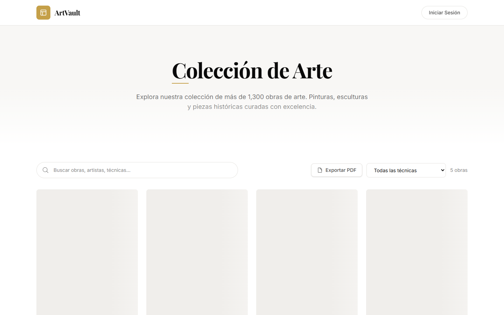
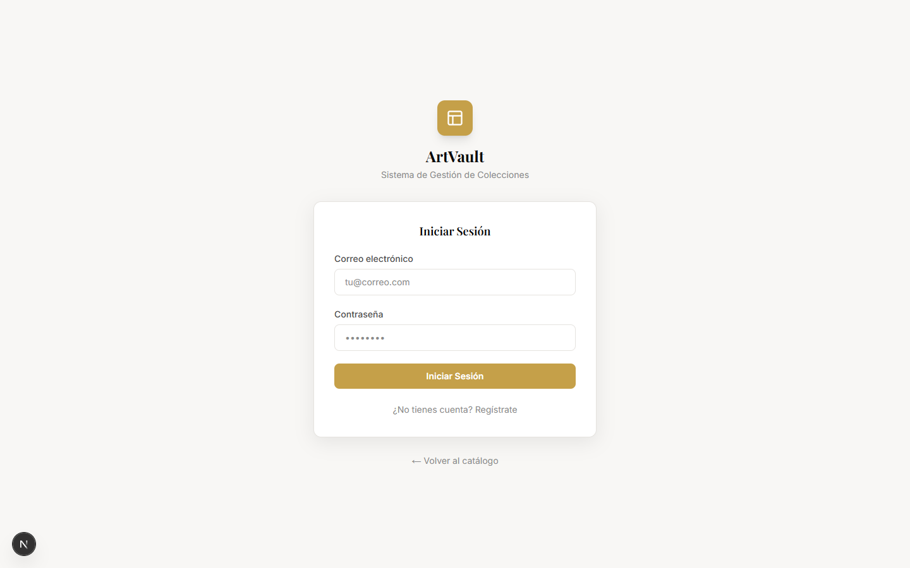
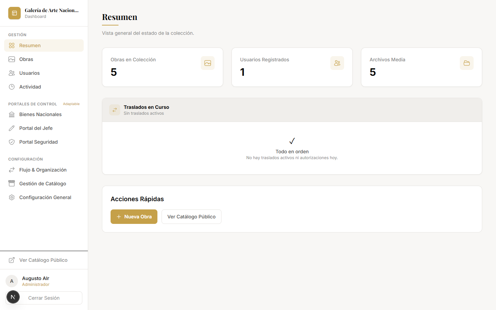
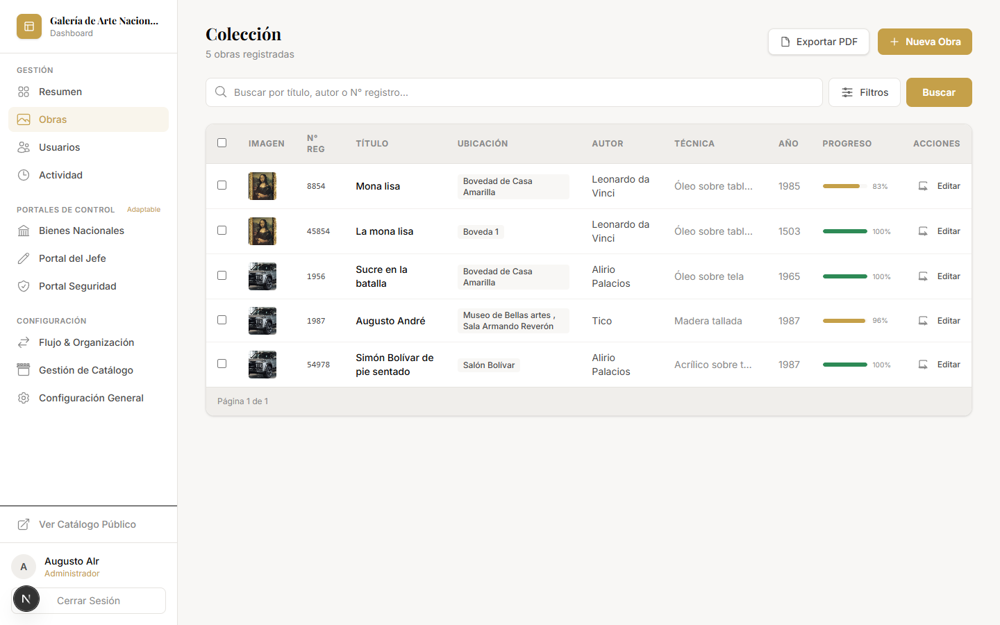
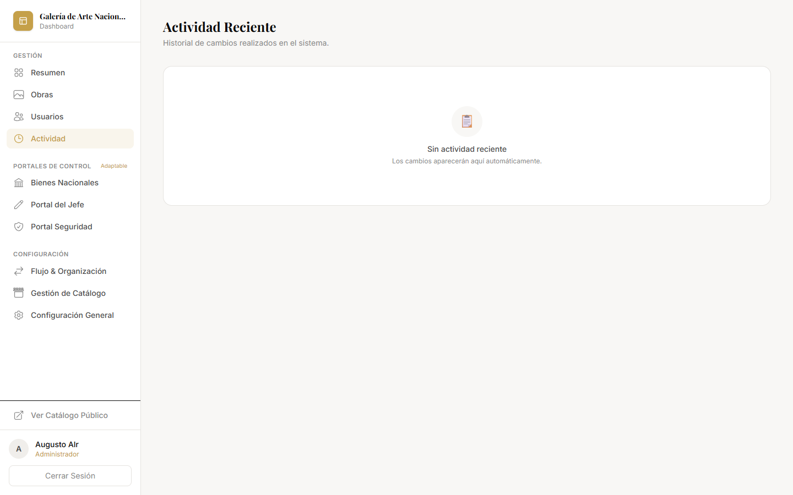
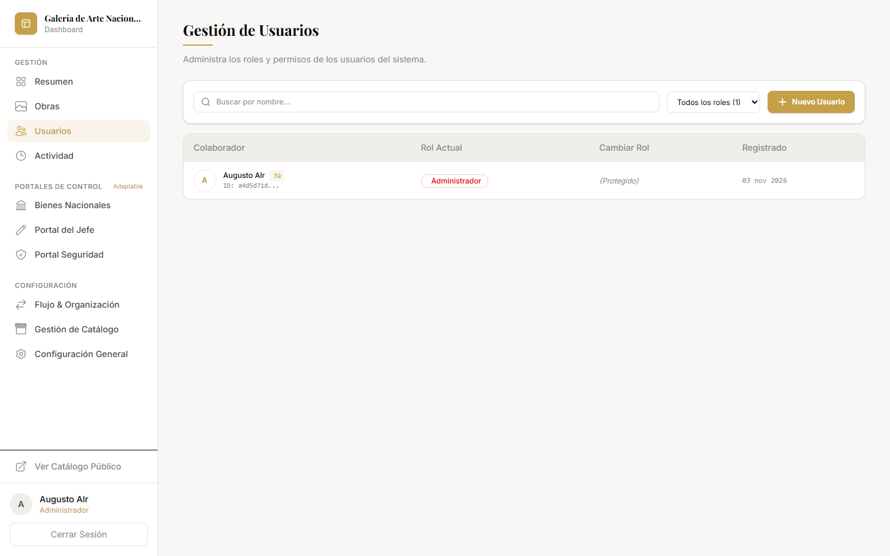
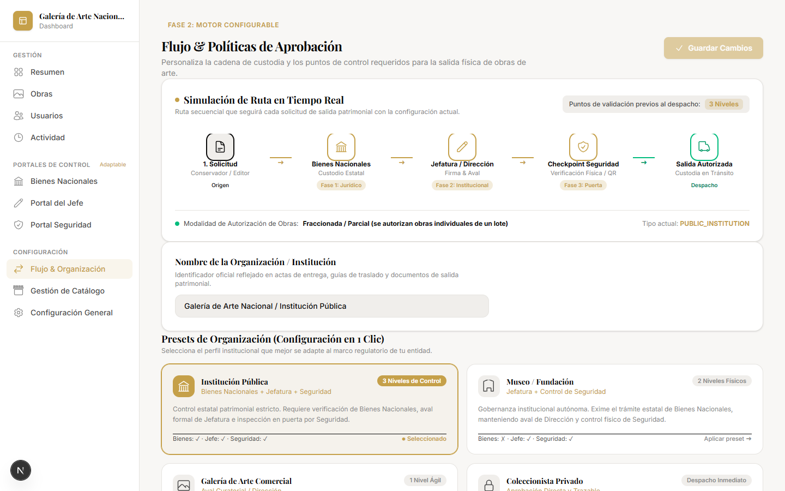
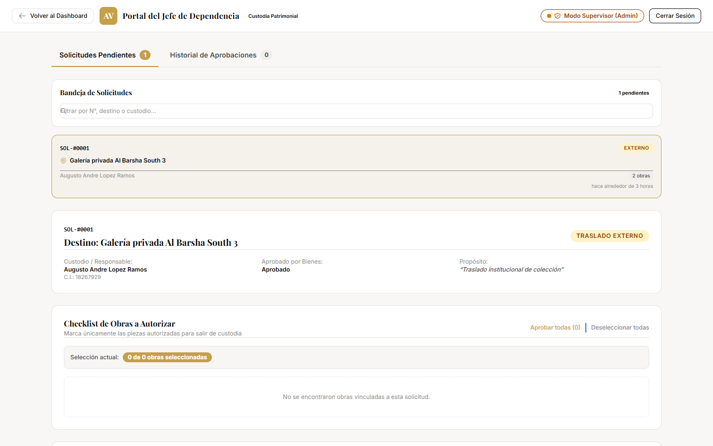
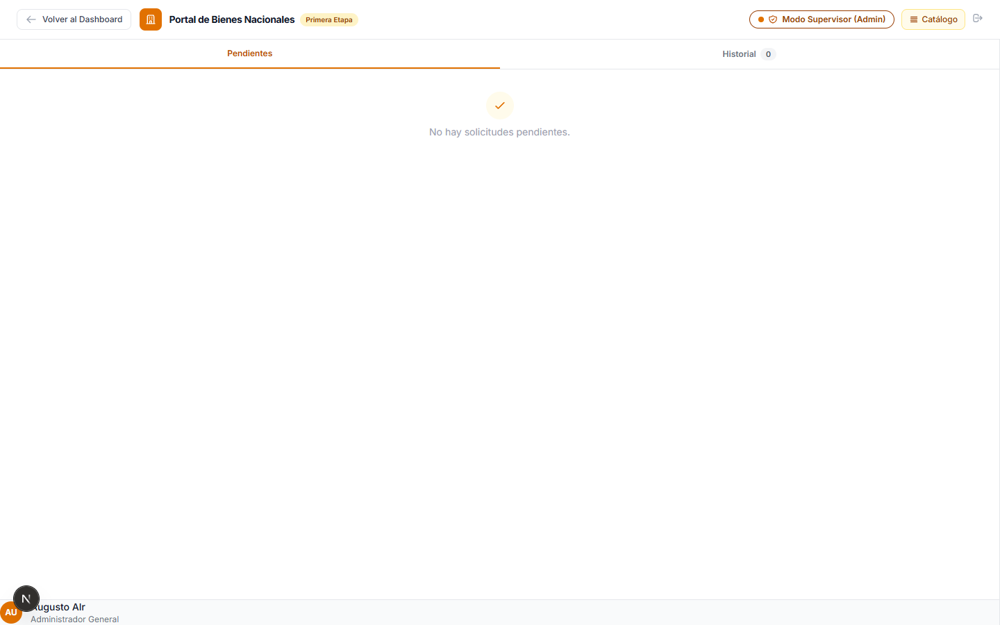
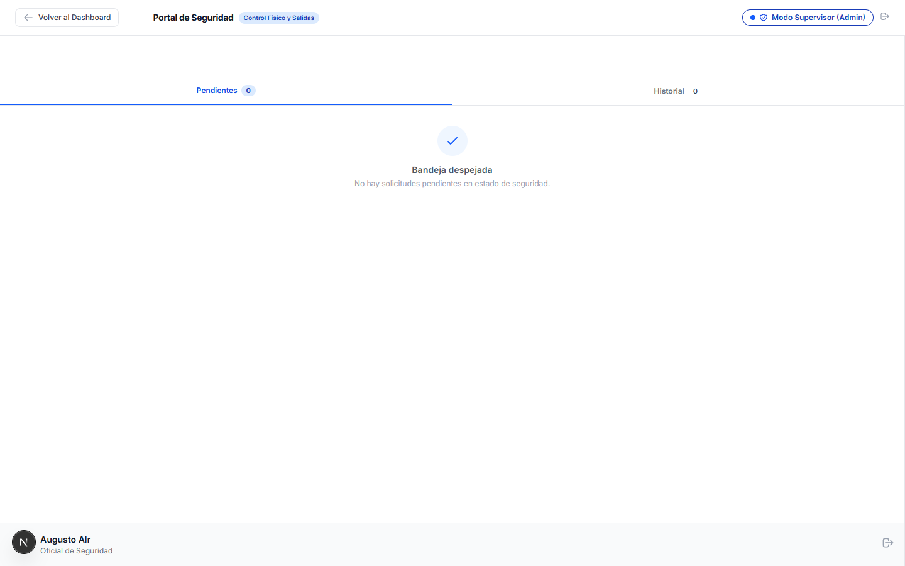

# 🏛️ ArtVault — Sistema de Gestión Patrimonial y Colecciones de Arte

[-black?style=flat&logo=next.js)](https://nextjs.org/)
[](https://www.typescriptlang.org/)
[](https://tailwindcss.com/)
[](https://supabase.com/)
[](#)

**ArtVault** es una plataforma integral de grado institucional y comercial diseñada para la catalogación, trazabilidad física, control de movimientos y flujos de autorización en múltiples fases de obras de arte y bienes patrimoniales.

---

## 📸 Recorrido Visual de Módulos y Secciones

### 1. Catálogo Público y Galería Institucional (`/`)
Exploración de la colección con imágenes reales sincronizadas con Supabase Storage, diseño de cuadrícula premium, filtros dinámicos, ficha técnica y paginación rápida.



---

### 2. Acceso y Control de Acceso Basado en Roles (`/login`)
Autenticación robusta y control de permisos granular (RBAC) para roles: `admin`, `editor`, `conservador`, `bienes`, `jefe`, `seguridad` y `visitante`.



---

### 3. Panel de Control y Métricas Ejecutivas (`/dashboard`)
Visión general del estado del acervo patrimonial: obras activas, en restauración, en préstamo o traslado, con accesos directos y resúmenes de auditoría.



---

### 4. Inventario General de Obras (`/dashboard/artworks`)
Gestión completa del catálogo con buscador reactivo, filtros por técnica, época, autor, ubicación física y la herramienta **Cesta de Movimiento por Lotes (Mover Lote)** con interfaz totalmente adaptada a dispositivos móviles.



---

### 5. Historial de Trazabilidad y Auditoría (`/dashboard/activity`)
Bitácora inmutable de traslados, inspecciones y modificaciones con marcas de tiempo, autorizaciones digitales y actas en formato PDF formal.



---

### 6. Gestión de Usuarios y Asignación de Roles (`/dashboard/users`)
Panel administrativo para crear nuevos usuarios con un clic, generar contraseñas temporales, asignar perfiles de acceso y modificar permisos en tiempo real.



---

### 7. Motor de Flujos de Aprobación y Presets (`/dashboard/settings/workflow`)
Configurador de rutas de autorización adaptable a cualquier entorno mediante presets de 1-clic y simulación interactiva del pipeline en tiempo real:
- **🏛️ Institución Pública:** Solicitud ➔ Peritaje Bienes ➔ Aval Jefatura ➔ Garita de Seguridad.
- **🏛️ Museo:** Solicitud ➔ Jefatura de Curaduría ➔ Inspección de Seguridad.
- **🖼️ Galería Privada:** Solicitud ➔ Aprobación y Firma de Dirección Comercial.
- **💼 Colección Privada:** Despacho directo con trazabilidad inmediata.



---

### 8. Portal del Jefe de Dependencia / Custodio (`/chief-portal`)
Bandeja especializada para Jefatura de Colecciones con:
- Pad de **Firma Digital Dual** (Canvas táctil interactivo o carga de sello institucional).
- Checklist para **Autorización Parcial** de piezas en traslados multi-obra.
- Modo Supervisor con botón de retorno al Dashboard.



---

### 9. Portal de Bienes Nacionales (`/bienes-portal`)
Bandeja de peritaje y aval de patrimonio nacional para la validación previa de salidas institucionales. Cuenta con **Modo Supervisor (Admin)** y navegación adaptada a pantallas móviles.



---

### 10. Portal del Oficial de Seguridad de Garita (`/security-portal`)
Punto de control e inspección física con:
- Banner de verificación del aval emitido previamente por Jefatura.
- Conteo de piezas autorizadas y visor de la firma registrada del custodio.
- Bloqueo estricto contra la salida de obras no autorizadas.



---

## 🛠️ Stack Tecnológico y Arquitectura

- **Framework Web:** [Next.js 16.1.6](https://nextjs.org/) con App Router y Turbopack.
- **Lenguaje:** TypeScript 5 en modo estricto.
- **Diseño & Estilos:** [Tailwind CSS v4](https://tailwindcss.com/) siguiendo el Sistema de Diseño Atómico y paleta Galería Premium.
- **Base de Datos & Auth:** [Supabase](https://supabase.com/) (`@supabase/ssr`, PostgreSQL, RLS, Storage Buckets para obras y firmas digitales).
- **Documentación & Actas:** [jsPDF](https://github.com/parallax/jsPDF) + jsPDF-AutoTable para actas formales de autorización.
- **Testing & Automatización:** Suite de pruebas con Node Test Runner (`verify-two-phase-auth.js` y `verify-workflow-engine.js`).

---

## 🚀 Puesta en Marcha Local

### Prerrequisitos
- Node.js >= 20
- npm / pnpm

### Instalación

1. Clonar el repositorio:
   ```bash
   git clone https://github.com/augustoalr/artvault-.git
   cd artico
   ```

2. Instalar dependencias:
   ```bash
   npm install
   ```

3. Configurar variables de entorno en `.env.local`:
   ```env
   NEXT_PUBLIC_SUPABASE_URL=tu_supabase_url
   NEXT_PUBLIC_SUPABASE_ANON_KEY=tu_supabase_anon_key
   ```

4. Iniciar el servidor de desarrollo:
   ```bash
   npm run dev
   ```
   Abrir [http://localhost:3000](http://localhost:3000) en el navegador.

---

## 🧪 Verificación y Pruebas

Ejecutar las pruebas automatizadas de reglas de negocio y compilación:

```bash
# Pruebas de reglas de autorización en dos fases
node scripts/verify-two-phase-auth.js

# Pruebas del motor de flujos adaptable
node scripts/verify-workflow-engine.js

# Verificación de tipos TypeScript
npx tsc --noEmit

# Compilación para producción
npm run build
```

---

## 📄 Licencia y Derechos
Desarrollado como plataforma integral de gestión de acervo artístico y patrimonial. Todos los derechos reservados.
